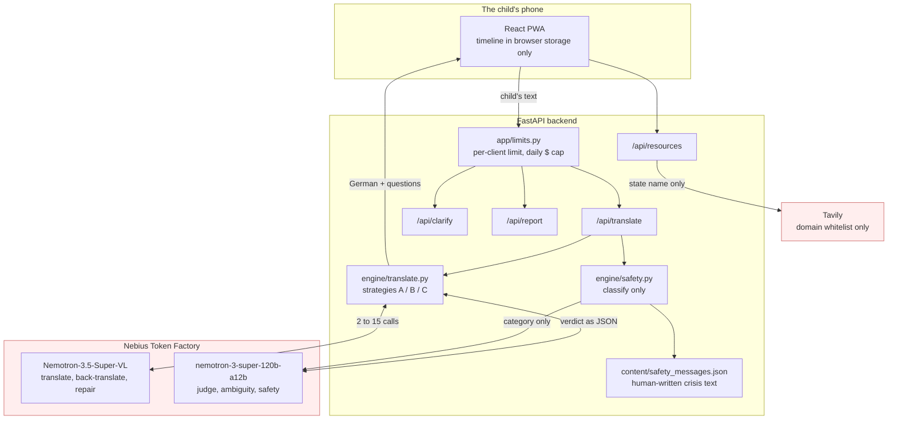

# Vividia

*Powered by NVIDIA Nemotron on Nebius Token Factory.*

A submission to the [Nebius x NVIDIA Global AI Hackathon](https://nebiusglobalaihackathon.devpost.com/),
track **Best Apps and Agents**.

> **Status:** in development (24–30 Oct 2026). Sections marked _TBD_ are
> filled in as features land; nothing is claimed here before it works.

## Why this exists

Some children never tell anyone they are being bullied. They freeze, they
don't have the words, or they have just arrived in Germany and don't speak
German yet. When they do try, the translation often comes from a classmate or
an app that guesses, and one wrong word changes everything: "my friend hits
me" read as "my friend meets me" is the difference between help and no help.

## What it does

A child checks in without words, writes in their own language, and sees a
German version that has been checked by several independent Nemotron passes.
When a sentence has two honest readings ("he said he would get me after
school": a threat or a lift home?), the app asks the child instead of
guessing, and always offers "something else". The child builds a timeline
they approve word by word, and chooses whether to show it to one trusted
adult, who also gets a short, sourced guide on how to respond.

**The child's words. The child's story. The child's choice.**

- Nothing is ever shared automatically. No monitoring, no automatic alerts,
  no AI "friend", no diagnosis.
- If the child says it happens at home, the app never suggests family members
  as the trusted adult.
- "Need help now?" is on every screen: 116 111, krisenchat and 110/112, each
  checked against its official source, plus the school psychology service in
  the child's state, looked up live and only from that state's official site.

It is a communication tool. It does not diagnose, decide whether an
allegation is true, counsel, or replace a safeguarding professional. It is a
hackathon research prototype.

### Languages

**English and Hindi (including Hinglish), into German.** We only ship and
measure languages our team can read: machine-made test data in other
languages had already lost the meaning in 17 of 18 cases, so we make no
quality claim for them. The architecture itself is language-independent.

### How your data is handled

Translation runs on Nebius, so **the text a child writes does leave the
device**. We will not pretend otherwise. What we do:

- The timeline is kept only in the child's own browser, and can be deleted.
- Our backend stores no disclosure and logs no message content.
- Nebius Zero Data Retention is enabled on our account: prompts and outputs
  are not stored after processing, and are never used to train any model.
- Quick exit leaves the page. It does not, and cannot, erase browser history.

Who could misuse the app or the phone, what we do about it, and our known
limitations are in [SAFETY.md](SAFETY.md).

## Architecture



Everything in red leaves the device. **The child's text goes to Nebius for
translation**; we do not pretend otherwise. Tavily receives a German state
name and never the child's words. The timeline is held in the browser.

## Where each service is used

**NVIDIA Nemotron**, two models with different jobs, on purpose. A judge that
shares the translator's blind spots cannot see the translator's mistakes.

| Model | Role | Where |
|-------|------|-------|
| `nvidia/Nemotron-3.5-Super-VL` | the fan-out: N independent translations, the back-translations, the repair pass | `engine/translate.py` |
| `nvidia/nemotron-3-super-120b-a12b` | the judge, the source-ambiguity check, the safety classifier | `engine/translate.py`, `engine/safety.py` |

Super-VL is the fan-out model **because of a measurement, not its name**.
`Nemotron-3_5-Lightning` won the English bake-off (`eval/bakeoff.py`) and was
the choice until `eval/language_gate.py` tested a language we ship: with
reasoning off it returned the Ukrainian input untranslated in 5 of 12 runs.
Super-VL and Super both failed 0 of 12.

**Nebius Token Factory** serves every model call at runtime, through one
client in `engine/client.py` that owns the per-model request limits, the retry
rules and the cost accounting. Zero Data Retention is enabled on our
organization, so prompts and outputs are not stored after processing. We do
**not** claim EU inference: public endpoints report region "Global".

**Tavily** looks up the school psychology service for the child's federal
state, restricted to a hand-checked official domain per state, with results
from any other host dropped in code (`engine/resources.py`). Children are
never shown unvetted web content. *Pending PR #2.*

## How the verification works

Three separate checks, because one model call cannot do all three jobs. Each
was added after watching the previous design fail on a real sentence.

1. **Fan-out and judge** catches one pass getting it wrong. Five independent
   translations at different temperatures; the judge keeps only those that say
   what the child said, then picks the most natural German among them.

2. **Back-translation and repair** catches *every* pass getting it wrong
   together, which is the failure that matters most. *"My friend hits me
   sometimes"* became *"Mein Freund **trifft** mich"* — my friend **meets** me —
   in all five passes, with agreement 1.00. Nothing disagreed, so nothing
   looked wrong. Only the back-translation showed it. A repair pass restores
   the harm, and confidence is capped at 0.6 whenever a repair was needed,
   because agreement had already proved worthless on that sentence.

3. **A separate ambiguity check on the child's own sentence** catches what no
   translation can resolve. *"He said he would get me after school"* is a
   threat or a lift home, and every pass chose the lift. Only the child knows,
   so the app asks — and the child's answer, not the model, decides the German.

The distinction that keeps this honest: a disagreement because a pass was
*wrong* is ours to fix silently (`translation_error`). A disagreement because
the child's words carry two honest readings is theirs to decide
(`source_ambiguous`). We never ask a child to adjudicate our own mistake.

`confidence` is **agreement between passes, not a correctness score.** They can
all agree and all be wrong; that is exactly what case 2 is.

### What it costs

Strategy **C (adaptive)** is what the app runs: two cheap passes first, and
the other eleven calls only when that sentence shows it needs them.

| | model calls | latency |
|---|---|---|
| a sentence that needs no verifying | 2 | [TBD] |
| full verification with a repair | 13 | [TBD] |

Call counts are exact: they are what the pipeline makes, asserted in
`backend/tests/test_latency.py`. Latency is left blank until it is measured on
the deployed demo rather than on a laptop.

## Running it

Requires Python 3.11+. From the repo root:

```bash
cd backend
py -m venv .venv
.venv\Scripts\activate          # macOS/Linux: source .venv/bin/activate
pip install -r requirements.txt
```

Copy `.env.example` (repo root) to `.env` and fill it in from the Nebius
Token Factory console. Never guess the base URL or a model ID:

```bash
python -m engine.smoke_test --list-models   # which model IDs your key can use
python -m engine.smoke_test                 # one Nemotron call
```

Run the API on the mock engine, which needs no key and costs nothing:

```bash
python -m uvicorn main:app --reload         # http://127.0.0.1:8000/docs
ENGINE_MODE=live python -m uvicorn main:app # real Nemotron calls
```

### The checks

Everything here is offline and spends nothing, which is also what CI runs
(`.github/workflows/ci.yml`).

```bash
cd backend
python -m pytest -q                      # the offline suite; no API key needed
python ../eval/load_test.py --requests 50  # 50 concurrent requests, mocked
```

The engine tests replay recorded transcripts from `backend/tests/fixtures/`,
so the repair pass and the question to the child are proved in CI without a
live call. Each transcript declares its `_provenance`, and a test enforces it:
the ones written by hand to reproduce an observation say so, and
`backend/tests/record_fixtures.py` replaces one with a captured transcript.

Tests that **do** spend credit are opt-in:

```bash
ENGINE_MODE=live python -m pytest tests/test_safety.py -v   # 17 live cases
python eval/bakeoff.py                                      # model bake-off
python eval/language_gate.py --languages hi                 # per-language gate
```

## Results

Reported only once measured, on sentences written by native speakers rather
than machine-translated. Nothing goes in this table before then.

| | baseline (A) | adaptive (C) |
|---|---|---|
| English, meaning kept | [TBD] | [TBD] |
| Hindi, meaning kept | [TBD] | [TBD] |
| mean model calls | [TBD] | [TBD] |

Measured so far, and reproducible:

- **Concurrency.** 50 simultaneous requests against the mock engine: 50/50
  served, p95 1532 ms, wall clock 1539 ms. The same work served one request
  at a time would take about 75 s. This measures our own concurrency only —
  in-process, no socket and no network.

**Not claimed.** We have no measured quality number for Arabic, Ukrainian or
Turkish, and we do not demo them. The language gate found that 17 of 18
machine-made test sentences had lost the detail being tested before our
pipeline saw them, which is why the test set is being written by native
speakers instead. We say the system is built and measured for **Hindi and
English**, and that the architecture is language-independent.

## Demo

- Live demo: _TBD_. No API key needed: press **"Try the demo story"** to load
  Amara's timeline, then send the prefilled sentence and watch the app ask
  what she meant. Amara is a made-up example; no real child is shown.
- Video: _TBD_
- Benchmark: 50 English and 30 Hindi sentences, drafted by the team with
  Claude's help and then read line by line by a team member who speaks the
  language, scored against a reference meaning with `eval/run_eval.py`.
  Results: _TBD; no number is published here until that review is signed off._

## Team

- Swarup Gaikwad
- Vernika Sharma
- Neel Shah

## License

MIT — see [LICENSE](LICENSE).
