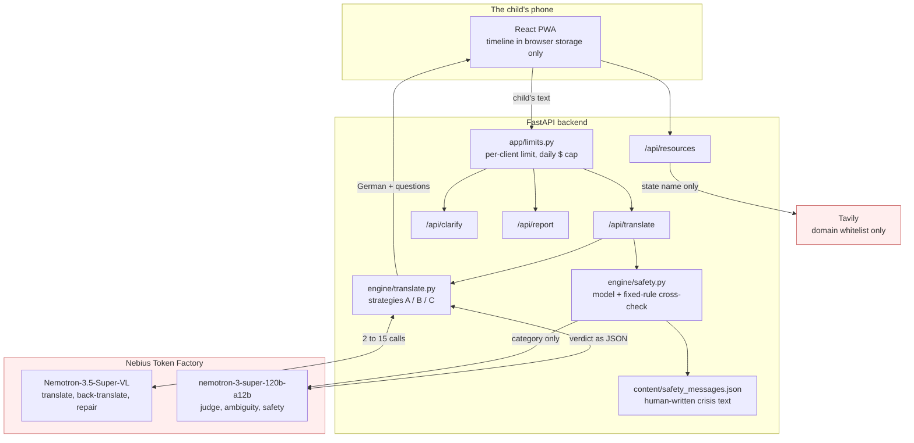

# Vividia

*Powered by NVIDIA Nemotron on Nebius Token Factory.*

A submission to the [Nebius x NVIDIA Global AI Hackathon](https://nebiusglobalaihackathon.devpost.com/),
track **Best Apps and Agents**.

> **Live demo: https://vividia-swarupgaikwad1801-ux.vercel.app** — no account, nothing to install. The free
> server sleeps when idle, so the first screen can take about 30 seconds;
> after that it is quick. Nothing is claimed here that the demo does not do.

## Why this exists

Some children never tell anyone they are being bullied. They freeze, they
don't have the words, or they have just arrived in Germany and don't speak
German yet. When they do try, the translation often comes from a classmate or
an app that guesses, and one wrong word changes everything: "my friend hits
me" read as "my friend meets me" is the difference between help and no help.

## What it does

A child checks in without words, writes in their own language, and sees a
German version that has been checked by several independent Nemotron passes.
When a sentence has two honest readings ("he said he would get me after
school": a threat or a lift home?), the app asks the child instead of
guessing, and always offers "something else". The child builds a timeline
they approve word by word, and chooses whether to show it to one trusted
adult, who also gets a short, sourced guide on how to respond.

**The child's words. The child's story. The child's choice.**

## Try it in 60 seconds

Open **https://vividia-swarupgaikwad1801-ux.vercel.app** on a phone or a laptop, pick a language, then:

1. **The question no translator asks.** Tap a face → **Write it my way** →
   type *"He said he would get me after school"* → **Write it down** → **Make
   a card**. Every pass translated it, and the app still stops to ask: *a
   threat, or a lift home?* Only the child knows. Answer, and the German
   follows the child's choice, not the model's guess. Do it twice: the second
   time it offers your earlier meaning first ("You meant this last time")
   but still lets you choose.
2. **Help that does not wait for the model.** Type *"He said he will bring a
   knife tomorrow"*. The danger screen opens with 110 / 112 to tap. The model
   and a set of fixed rules both read every message, so this works even if
   the model is slow or down. Nothing is sent to anyone.
3. **No words needed.** Tap a face → **Tap pictures** → pick tiles → **Make a
   card** → **Auf Deutsch**: the card turns over for the teacher.

Always on screen: **Need help** (helplines, works offline) and **Leave now**
(or Esc three times), which leaves in under a second.

If the top of the screen says **Example mode**, the server is running
without the models: you see the app working, but the German is a fixed
example and the app says so.

The public demo has a daily spending cap. Once half of it is used, the chat
answers with its reviewed sentences instead of writing its own. When all of
it is used, the app says *"The translation is not working today…"* until the
next day, with krisenchat and 116 111 in the same message; **Need help**
keeps working, because it needs no model.

- Nothing is ever shared automatically. No monitoring, no automatic alerts,
  no AI "friend", no diagnosis.
- If the child says it happens at home, the app never suggests family members
  as the trusted adult.
- "Need help now?" is on every screen: 116 111, krisenchat and 110/112, each
  checked against its official source, with their hours and the languages
  they answer in.

It is a communication tool. It does not diagnose, decide whether an
allegation is true, counsel, or replace a safeguarding professional. It is a
hackathon research prototype.

### Languages

**English and Hindi (including Hinglish), into German.** We only ship and
measure languages our team can read: machine-made test data in other
languages had already lost the meaning in 17 of 18 cases, so we make no
quality claim for them. The architecture itself is language-independent.

### How your data is handled

Translation runs on Nebius, so **the text a child writes does leave the
device**. We will not pretend otherwise. What we do:

- The timeline is kept only in the child's own browser, and can be deleted.
- Our backend stores no disclosure and logs no message content.
- Nebius Zero Data Retention is enabled on our account: prompts and outputs
  are not stored after processing, and are never used to train any model.
- Quick exit leaves the page. It does not, and cannot, erase browser history.

Who could misuse the app or the phone, what we do about it, and our known
limitations are in [SAFETY.md](SAFETY.md).

## Architecture



Everything in red leaves the device. **The child's text goes to Nebius for
translation**; we do not pretend otherwise. Tavily receives a German state
name and never the child's words. The timeline is held in the browser.

## Where each service is used

**NVIDIA Nemotron**, two models with different jobs, on purpose. A judge that
shares the translator's blind spots cannot see the translator's mistakes.

| Model | Role | Where |
|-------|------|-------|
| `nvidia/Nemotron-3.5-Super-VL` | the fan-out: N independent translations, the back-translations, the repair pass; in the chat, what kind of thing the child said and the chat's own short answer | `engine/translate.py`, `engine/listen.py` |
| `nvidia/nemotron-3-super-120b-a12b` | the judge, the source-ambiguity check, the safety classifier; in the chat, the second check every written answer must pass | `engine/translate.py`, `engine/safety.py`, `engine/listen.py` |

Both are called through **Nebius Token Factory**'s OpenAI-compatible chat
completions API (`engine/client.py`). No other Nebius services are used.

Super-VL is the fan-out model **because of a measurement, not its name**.
`Nemotron-3_5-Lightning` won the English bake-off (`eval/bakeoff.py`) and was
the choice until `eval/language_gate.py` tested a language we ship: with
reasoning off it returned the Ukrainian input untranslated in 5 of 12 runs.
Super-VL and Super both failed 0 of 12.

**Nebius Token Factory** serves every model call at runtime, through one
client in `engine/client.py` that owns the per-model request limits, the retry
rules and the cost accounting. Zero Data Retention is enabled on our
organization, so prompts and outputs are not stored after processing. We do
**not** claim EU inference: public endpoints report region "Global".

**Tavily** finds the school psychology service (schulpsychologische
Beratungsstelle) for a German federal state. It is all in
`backend/engine/resources.py`, served by `GET /api/resources?lang=en&state=BW`:

- **One hand-checked official domain per state**, all 16 (`STATE_SITES`),
  passed to Tavily as `include_domains`. Any result from another host is
  dropped again in code, and the page we read details from is checked a
  second time before it is fetched. A state code not in the list gets no
  search at all, only the curated helplines.
- **What is sent:** the state's name in a fixed German query
  (`Schulpsychologische Beratungsstelle <state> Kontakt`). Never anything the
  child wrote: the function does not receive it.
- **What comes back:** the page's title and link. One Tavily Extract call on
  the best page adds a phone number only when the page labels it as one
  ("Tel.", "Telefon"…) near a mention of the service, and opening hours only
  when they name a day and "Uhr". Otherwise the entry says "Siehe Webseite"
  rather than guess.
- **Cost control:** at most 20 Tavily requests a day (`TAVILY_DAILY_CAP`),
  counted before each request goes out; each state's result is cached for 24
  hours; the day's count is visible on `/api/health`. Past the cap, or with no
  key, the response is the curated helplines, marked `source: "fallback"`.
- **Not used for:** emergency numbers (110/112), the helplines (116 111,
  krisenchat) or anything the model does. Those come from
  `content/helplines.json`, which is checked by hand, and never depend on the
  network.

**What the app's screens do today:** the help screen and the danger pop-up
call `/api/resources` *without* a state, so in the deployed app they show
the curated list and no Tavily request is made. The state lookup is
reachable through the API (above). It was verified on the deployed backend on
26 Oct: Baden-Württemberg returned the official ZSL Regionalstellen, marked
`source: "live"`.

## How the verification works

Three separate checks, because one model call cannot do all three jobs. Each
was added after watching the previous design fail on a real sentence.

1. **Fan-out and judge** catches one pass getting it wrong. Five independent
   translations at different temperatures; the judge keeps only those that say
   what the child said, then picks the most natural German among them.

2. **Back-translation and repair** catches *every* pass getting it wrong
   together, which is the failure that matters most, because nothing
   disagrees and so nothing looks wrong. While we were building on Nemotron
   3.5 Lightning, *"My friend hits me sometimes"* became *"Mein Freund
   **trifft** mich"* — my friend **meets** me — in all five passes at
   agreement 1.00, and only the back-translation showed it. **That example no
   longer reproduces:** on Nemotron 3.5 Super-VL, which we now use, a single
   pass gets it right 5 times out of 5. We keep the step because the failure
   is silent when it happens, and we say plainly that we can no longer
   demonstrate it on this model. A repair restores the lost meaning, and
   confidence is capped at 0.6 whenever a repair was needed.

3. **A separate ambiguity check on the child's own sentence** catches what no
   translation can resolve. *"He said he would get me after school"* is a
   threat or a lift home, and every pass chose the lift. Only the child knows,
   so the app asks — and the child's answer, not the model, decides the German.

The distinction that keeps this honest: a disagreement because a pass was
*wrong* is ours to fix silently (`translation_error`). A disagreement because
the child's words carry two honest readings is theirs to decide
(`source_ambiguous`). We never ask a child to adjudicate our own mistake.

`confidence` is **agreement between passes, not a correctness score.** They can
all agree and all be wrong; that is exactly what case 2 is.

4. **Cross-checks in code, at no extra cost** (added 28 Oct). Two agreeing
   passes are only trusted when nothing else objects: a sentence with
   negation, force or a threat — in English, German, and Hindi in Roman or
   Devanagari letters — goes to the full verification, and so does one whose
   agreed German **dropped a number** the child wrote ("3 times", "5 euros").
   On the Hindi test set this raised the share of sentences that get the full
   check from 0 of 30 to 11 of 30. The safety check is two checks as well:
   the model, and fixed rules that can raise the help prompt when the model
   misses a plain threat or is down, but can never lower it.

### What it costs

Strategy **C (adaptive)** is what the app runs: two cheap passes first, and
the other thirteen calls only when that sentence shows it needs them.

| | model calls | latency |
|---|---|---|
| a sentence that needs no verifying | 2 | about 1–2 s |
| the eval's average sentence (C) | 9.6–11.4 | 7–11 s |
| full verification with a repair | 15 | longer than the average |

Call counts for the first and last rows are exact: they are what the pipeline
makes, asserted in `backend/tests/test_latency.py`. The middle row is measured:
the averages of the two eval runs below (24–25 Oct, a laptop calling Token
Factory). A single call measured 1.2–1.3 s and the first two calls run in
parallel. The deployed demo adds a cold start of up to ~30 s after idle.

## Running it

Requires Python 3.11+. From the repo root:

```bash
cd backend
py -m venv .venv
.venv\Scripts\activate          # macOS/Linux: source .venv/bin/activate
pip install -r requirements.txt
```

Copy `.env.example` (repo root) to `.env` and fill it in from the Nebius
Token Factory console. Never guess the base URL or a model ID:

```bash
python -m engine.smoke_test --list-models   # which model IDs your key can use
python -m engine.smoke_test                 # one Nemotron call
```

Run the API on the mock engine, which needs no key and costs nothing:

```bash
python -m uvicorn main:app --reload         # http://127.0.0.1:8000/docs
ENGINE_MODE=live python -m uvicorn main:app # real Nemotron calls
```

The app itself, in a second terminal. Requires Node 20.19+ or 22.12+ (Vite 8). From the repo root:

```bash
cd frontend
npm ci
cp .env.example .env.local      # Windows: copy .env.example .env.local
npm run dev                     # http://localhost:5173, talks to the API above
npm test                        # the frontend tests; npm run build checks types
```

### The checks

Everything here is offline and spends nothing, which is also what CI runs
(`.github/workflows/ci.yml`).

```bash
cd backend
python -m pytest -q                      # the offline suite; no API key needed
python ../eval/load_test.py --requests 50  # 50 concurrent requests, mocked
```

The engine tests replay recorded transcripts from `backend/tests/fixtures/`,
so the repair pass and the question to the child are proved in CI without a
live call. Each transcript declares its `_provenance`, and a test enforces it:
the ones written by hand to reproduce an observation say so, and
`backend/tests/record_fixtures.py` replaces one with a captured transcript.

Tests that **do** spend credit are opt-in:

```bash
ENGINE_MODE=live python -m pytest tests/test_safety.py -v   # 17 live cases
python ../eval/bakeoff.py                                   # model bake-off
python ../eval/language_gate.py --languages hi              # per-language gate
```

## Results

**Preliminary.** The test sentences were drafted by the team with Claude's
help, not machine-translated. The native-speaker review is still pending:
`_review` in `eval/testset/*.json` is empty, so these numbers may move.

Two full runs of the same sets, a day apart (`eval/results/`, files
`*_20261024T22*` and `*_20261025T16*`):

| | single pass (A) | ours (C), 24 Oct | ours (C), 25 Oct |
|---|---|---|---|
| English (50), meaning kept | 48/50 | 49/50 | 48/50 |
| Hindi (30), meaning kept | 28/30 | 28/30 | 27/30 |
| **Total** | **76/80** | **77/80** | **75/80** |
| mean model calls | 1 | 10.5 | 10.3 |
| missed crises (safety set) | – | 0 | 0 |

**On accuracy the two are level.** The models are not deterministic, so ours
moves by a sentence or two between runs, which on 80 sentences is noise, and
we do not claim a win. What the extra calls buy is the questions: where a
sentence carried two honest meanings, the app asked the child instead of
guessing. How often is not given here: the run files and #52 count it
differently, so the count waits for the re-run. Both runs predate the 28 Oct cross-checks (point 4
above); a rerun is pending.

Measured so far, and reproducible:

- **Concurrency.** 50 simultaneous requests against the mock engine: 50/50
  served, p95 1532 ms, wall clock 1539 ms. The same work served one request
  at a time would take about 75 s. This measures our own concurrency only —
  in-process, no socket and no network.

**Not claimed.** We have no measured quality number for Arabic, Ukrainian or
Turkish, and we do not demo them. The language gate found that 17 of 18
machine-made test sentences had lost the detail being tested before our
pipeline saw them, which is why the test set is being written by native
speakers instead. We say the system is built and measured for **Hindi and
English**, and that the architecture is language-independent.

## Demo

- Live demo: **https://vividia-swarupgaikwad1801-ux.vercel.app** (see **Try it in 60 seconds** above).
- Video: _TBD_
- Benchmark (preliminary): 50 English and 30 Hindi sentences, drafted by
  the team with Claude's help, native-speaker review pending, scored against
  a reference meaning with `eval/run_eval.py`.
  Results: **76/80 for a single pass; 77/80 and 75/80 for ours** in two
  runs a day apart - level, since a sentence or two in eighty is noise, not
  a difference (table in **Results**).
  What the extra calls buy is the sentences where the child's own words
  had two meanings and the app asked them instead of guessing. 0 missed
  crises on the safety set. Numbers stand once the native review of the
  sentences is signed off; the method and raw output are in `eval/`.

## Team

- Swarup Gaikwad
- Vernika Sharma
- Neel Shah

## License

MIT — see [LICENSE](LICENSE).
