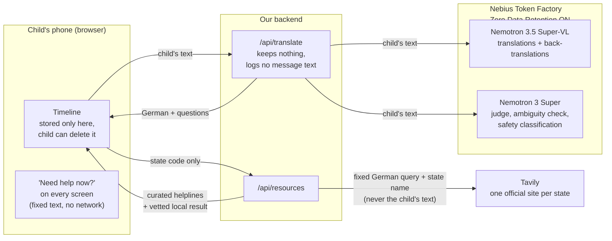

# SAFETY.md

Neel owns this file. **Updated 24 Oct 2026** to match `main` and the open
PRs. It is the honest account of where a child's words go, who could misuse
the app or the phone, what we do about it, and what we cannot do. Nothing
marked *planned* or *requested* is claimed anywhere else until it ships.

Status key: **done** (on `main`) · **in PR** (written, waiting for review) ·
**assigned** (in a task issue) · **limitation** (we cannot fix it; we say so).

## Where the child's words go

- The disclosure **does leave the phone** for translation and the safety
  check. We say so in the README, the onboarding screens and the app.
- Nebius Zero Data Retention is enabled on our organisation: prompts and
  outputs are not stored after processing and never used for training.
- We do **not** claim "EU inference": public Token Factory endpoints report
  region "Global".
- Tavily never receives anything the child wrote. `resources.py` does not
  even accept the text; only the state code reaches it.

## Who could cause harm, and what we do

| # | Threat | What we do | Status |
|---|--------|------------|--------|
| 1 | **The trusted adult the child picks is the person hurting them** (harm at home) | The app asks "where does this happen?". If home, family is never suggested at any step. The rule is written into `content/adult_guide.json` and `demo_story.json`; the screen is Vernika's | content in PR #9; screen assigned (#4) |
| 2 | **Someone else picks up the phone** (parent, sibling, the bully) | PIN lock; quick exit in under 1 s; neutral app name and icon | assigned (#4) |
| 3 | Quick exit gives a false sense of safety | Quick exit leaves the page; it **cannot** erase browser history, and the onboarding text says so | limitation, stated in PR #9 |
| 4 | **The child has no phone of their own** | Works in any browser, so a shared school tablet or social worker's device works too; nothing stored on our server | by design; PIN per child assigned (#4) |
| 5 | **A false or revenge report** | The report is "the child's own words, which they approved", never a verdict (adult guide footer). The app never names, contacts or notifies anyone | content in PR #9; "never contacts" requested in #1 |
| 6 | **A translation changes the meaning** ("hits me" → "trifft mich", meets me) | Fan-out + back-translation compared with the original + repair; a *different* model judges; confidence capped after repair; output that echoes the input is rejected | done |
| 7 | **A clarifying question leads the child** | Only real two-meaning phrases are asked, never our own mistakes; always a third option "something else, I'll explain" | two-reading rule done; third option assigned (#3) |
| 8 | **The child is in danger right now** | The model only classifies; the code decides; the words a child in crisis sees are fixed, human-written text with verified contacts. Detection is a prompt, not a gate: the help button is on every screen whether or not it fires. Tuned against false alarms ("my mum will kill me") | done; contact sources in PR #7 |
| 9 | A web search shows a child unvetted content | Tavily restricted to one hand-checked official site per state, all 16 states; other hosts dropped in code; unknown codes get curated helplines only | in PR #2 (tested) |
| 10 | A helpline number or hours are out of date | Every contact carries its source and check date; re-checked before the demo and before 15 Dec | in PR #2 and #7 |
| 11 | The app is mistaken for counselling, diagnosis or legal advice | Onboarding says it is "not a person and not a doctor"; no AI friend, no diagnosis, no judgement on whether something is true | in PR #9 |
| 12 | Someone abuses the public demo and drains credits | Per-IP rate limit and daily spending cap | assigned (#11) |
| 13 | A model error or timeout shows a child a stack trace | Every failure returns a calm `message_child` | assigned (#11) |
| 14 | An API key leaks | Keys only in `.env` (gitignored); rotate on any leak; CI runs without secrets | done; CI assigned (#11) |

## German context we design for

- Children under 16 cannot consent alone to most data processing under the
  GDPR as applied in Germany. We avoid the question instead of claiming
  compliance: **no account, nothing stored on our server**, timeline only in
  the child's browser. We do not claim GDPR compliance; we cite only the
  certifications Nebius holds.
- Schools and youth welfare services follow a duty-to-protect process
  (§ 8a SGB VIII, § 4 KKG). Our escalation ladder points the child toward the
  people inside that process; the app never replaces it.

## Known limitations (published, not hidden)

- Consensus measures agreement, not correctness. Where every pass is wrong in
  the same way, only the back-translation check or the child can catch it.
- We ship and measure only **English and Hindi**, the languages our team reads.
  Machine-made test data in other languages had already lost the meaning in
  17 of 18 cases, so we make no quality claim for them. Picture mode is for
  every other child.
- The safety check can miss a crisis. That is accepted on purpose, because
  help is reachable on every screen regardless.
- No real children tested the app. Usability feedback comes from adults
  playing a fictional scenario, and we say so.
