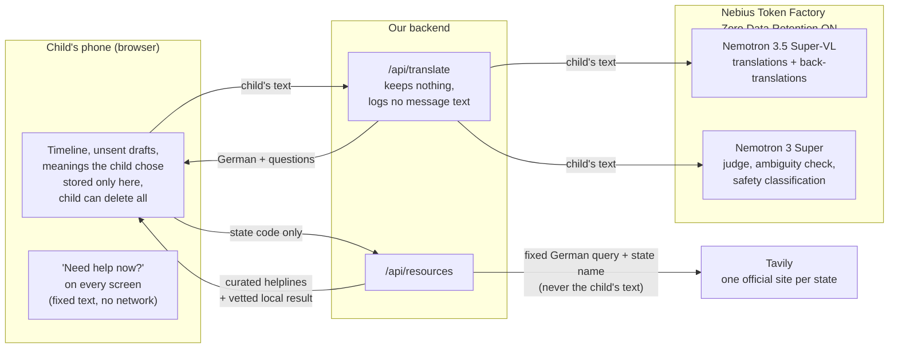

# SAFETY.md

Neel owns this file. **Updated 24 Oct 2026** to match `main` and the open
PRs; **statuses re-checked 28 Oct 2026** against `main` and the live demo
(each "done" below was checked in the code or in a browser that day). It is the honest account of where a child's words go, who could misuse
the app or the phone, what we do about it, and what we cannot do. Nothing
marked *planned* or *requested* is claimed anywhere else until it ships.

Status key: **done** (on `main`) · **in PR** (written, waiting for review) ·
**assigned** (in a task issue) · **limitation** (we cannot fix it; we say so).

## Where the child's words go

- The disclosure **does leave the phone** for translation and the safety
  check. We say so in the README, the onboarding screens and the app.
- Nebius Zero Data Retention is enabled on our organisation: prompts and
  outputs are not stored after processing and never used for training.
- We do **not** claim "EU inference": public Token Factory endpoints report
  region "Global".
- Tavily never receives anything the child wrote. `resources.py` does not
  even accept the text; only the state code reaches it.

## Who could cause harm, and what we do

| # | Threat | What we do | Status |
|---|--------|------------|--------|
| 1 | **The trusted adult the child picks is the person hurting them** (harm at home) | The app asks "where does this happen?". If home, family is never suggested at any step. The rule is written into `content/adult_guide.json` and `demo_story.json`; the screen is Vernika's | done: the handoff never suggests family when it happens at home, and says why |
| 2 | **Someone else picks up the phone** (parent, sibling, the bully) | PIN lock (4–6 digits, salted hash, a delay after five wrong tries that is capped at 60 s so it can never lock the child out); quick exit in under 1 s; neutral app name and icon. **The honest limit, by decision (25 Oct):** "I forgot my PIN" removes the PIN without asking for it and keeps everything saved, because wiping the timeline would destroy the words a child was about to show an adult. So anyone holding the phone can also remove it: the PIN stops someone who picks the phone up, not someone determined, and the screen says so in those words. After a reset the timeline shows when the PIN was removed, so the child can see if someone else did it. The PIN guards the screens, not the data: the timeline is not encrypted | done: set PIN, lock after reload, wrong PIN refused, words hidden behind the lock, Leave now on the lock (browser-checked 28 Oct) |
| 3 | Quick exit gives a false sense of safety | Quick exit leaves the page; it **cannot** erase browser history, and the onboarding text says so | limitation, stated in the onboarding ("It does not delete your browser history") |
| 4 | **The child has no phone of their own** | Works in any browser, so a shared school tablet or social worker's device works too; nothing stored on our server | by design. **Limitation:** one PIN per browser, so children sharing a tablet share one lock and one timeline; each child should use their own browser profile or device |
| 5 | **A false or revenge report** | The report is "the child's own words, which they approved", never a verdict (adult guide footer). The app never names, contacts or notifies anyone | done: onboarding says "The app tells nobody behind your back" |
| 6 | **A translation changes the meaning** ("hits me" → "trifft mich", meets me) | Fan-out + back-translation compared with the original + repair; a *different* model judges; confidence capped after repair; output that echoes the input is rejected | done |
| 7 | **A clarifying question leads the child** | Only real two-meaning phrases are asked, never our own mistakes; always a third option "something else, I'll explain" | done (#18: every question carries "something else") |
| 8 | **The child is in danger right now** | The model only classifies; the code decides; the words a child in crisis sees are fixed, human-written text with verified contacts. Detection is a prompt, not a gate: the help button is on every screen whether or not it fires. Tuned against false alarms ("my mum will kill me") | done. Since 28 Oct a second, independent check: fixed rules beside the model can raise the prompt when the model misses a plain threat or is down, never lower it, and are held to the same "must not fire" list |
| 9 | A web search shows a child unvetted content | Tavily restricted to one hand-checked official site per state, all 16 states; other hosts dropped in code; unknown codes get curated helplines only | done: verified live on the deployed backend, 26 Oct |
| 10 | A helpline number or hours are out of date | Every contact carries its source and check date; re-checked before the demo and before 15 Dec | done: each helpline on the help screen shows its source link and "checked N days ago" |
| 11 | The app is mistaken for counselling, diagnosis or legal advice | Onboarding says it is "not a person and not a doctor"; no AI friend, no diagnosis, no judgement on whether something is true | done: onboarding says "It is not a person and not a doctor" |
| 12 | Someone abuses the public demo and drains credits | Per-IP rate limit and daily spending cap | done: `backend/app/limits.py` (40 requests per hour per client, daily $ cap) |
| 13 | A model error or timeout shows a child a stack trace | Every failure returns a calm `message_child` | done: e.g. the rate limit shows "Wait a moment, then try again. Your words are still here." |
| 14 | An API key leaks | Keys only in `.env` (gitignored); rotate on any leak; CI runs without secrets | done; CI runs both test suites on every PR without secrets |
| 15 | **Someone glances at the phone's app switcher** | The page goes blank the moment the app is hidden, so the preview shows nothing (like Signal's Screen Security) | done, best effort: a browser may take its preview first |
| 16 | **Half-written words are left on the phone** | Unsent text is kept so a closed tab does not lose it, but Leave now wipes it before leaving, and Delete everything wipes it | done, browser-checked 28 Oct |
| 17 | **The app remembers too much about the child** | Only on the phone, and only: the days the app was opened (last 28, dates only), and the reading the child chose for a phrase (up to 50). No streaks, no mood history. Delete everything clears all of it; a test fails if a new storage key is not covered | done |
| 18 | **The live app cannot reach its backend** and shows a frightened child "no internet" | Found 28 Oct (the browser blocked every call). The production address is now allowed in code, not only in a dashboard setting, with tests that other sites are still refused | done |

## German context we design for

- Children under 16 cannot consent alone to most data processing under the
  GDPR as applied in Germany. We avoid the question instead of claiming
  compliance: **no account, nothing stored on our server**, timeline only in
  the child's browser. We do not claim GDPR compliance; we cite only the
  certifications Nebius holds.
- Schools and youth welfare services follow a duty-to-protect process
  (§ 8a SGB VIII, § 4 KKG). Our escalation ladder points the child toward the
  people inside that process; the app never replaces it.

## Known limitations (published, not hidden)

- Consensus measures agreement, not correctness. Where every pass is wrong in
  the same way, only the back-translation check or the child can catch it.
- We ship and measure only **English and Hindi**, the languages our team reads.
  Machine-made test data in other languages had already lost the meaning in
  17 of 18 cases, so we make no quality claim for them. Picture mode is for
  every other child.
- The safety check can miss a crisis. That is accepted on purpose, because
  help is reachable on every screen regardless.
- No real children tested the app. Usability feedback comes from adults
  playing a fictional scenario, and we say so.
